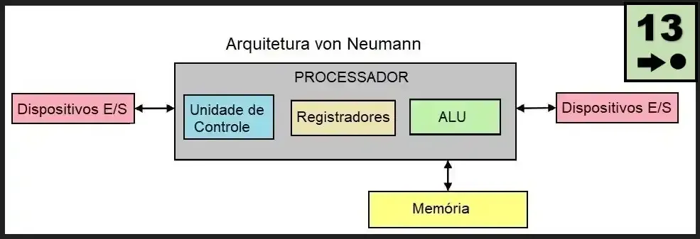

# O Gargalo de Von Neumann e a Necessidade do Paralelismo

Vamos entender por que a computação moderna foi "forçada" a se tornar paralela. Para programar sistemas distribuídos e paralelos de alta performance, o primeiro passo é compreender os limites físicos do hardware sequencial.

---

## 1. A Metáfora do Restaurante: O Chef e a Despensa

Imagine que você é o proprietário de um restaurante de altíssimo padrão:

* **A CPU (O Chef de Cozinha):** É um chef genial, capaz de picar legumes e montar pratos a uma velocidade sobre-humana — digamos, 3 bilhões de ações por segundo (3 GHz).
* **A Memória RAM (A Despensa):** É a sala onde ficam guardados todos os ingredientes (dados) e as fichas técnicas de receitas (instruções). Ela fica no final de um longo corredor.
* **O Barramento / Datapath (O Corredor):** É o único caminho que conecta a cozinha à despensa.

Se o Chef precisa de um ingrediente para cada passo da receita, ele precisa enviar um assistente pelo corredor até a despensa, pegar o ingrediente e voltar. Por mais rápido que o Chef seja cortando o ingrediente, a velocidade final da prato entregue não depende da velocidade das mãos do Chef, mas sim de **quantas vezes e quão rápido o assistente consegue ir e voltar pelo corredor**.

Esse é o dilema fundamental da **Arquitetura Von Neumann**.

---

## 2. A Arquitetura de Von Neumann (1945)

Proposta pelo matemático John von Neumann, essa arquitetura é a base de praticamente todos os computadores modernos.

```
+---------------------------------------------------+
|               UNIDADE CENTRAL (CPU)               |
|  +-------------------+   +---------------------+  |
|  | Unidade Controle  |   | ULA (Aritmética)    |  |
|  +-------------------+   +---------------------+  |
|  | Registradores (PC, IR, Registradores de uso) |  |
|  +---------------------------------------------+  |
+-------------------------+-------------------------+
                          |
              BARRAMENTO DE DADOS E INSTRUÇÕES
              (Datapath / System Bus)
                          |
+-------------------------+-------------------------+
|                  MEMÓRIA PRINCIPAL (RAM)          |
|  +---------------------------------------------+  |
|  | Espaço de Endereçamento Compartilhado       |  |
|  | (Contém Instruções do Programa e Dados)     |  |
|  +---------------------------------------------+  |
+---------------------------------------------------+
```

*Diagrama clássico de blocos da Arquitetura Von Neumann mostrando a CPU contendo UC, ULA e Registradores conectados à Memória RAM por um barramento comum de dados e instruções.*




### Os Componentes Principais:
1. **CPU (Unidade Central de Processamento):**
   * **Unidade de Controle (UC):** Orienta o fluxo de dados e decodifica as instruções.
   * **Unidade Lógica e Aritmética (ULA / ALU):** Realiza as operações matemáticas (soma, multiplicação) e lógicas (E, OU, comparações).
   * **Registradores:** Memórias internas ultrarrápidas (como o *Program Counter* - PC e o *Instruction Register* - IR).
2. **Memória Principal (RAM):** Um espaço contíguo de memória onde **dados e instruções do programa residem juntos** [199].
3. **Barramento de Sistema (*Datapath*):** Conjunto de linhas elétricas que transportam endereços, dados e sinais de controle [71].

### O Ciclo Tradicional (*Fetch-Decode-Execute*):
1. **Busca (*Fetch*):** A CPU busca a instrução na RAM através do barramento.
2. **Decodificação (*Decode*):** A Unidade de Controle traduz a instrução.
3. **Busca de Operandos:** Se a instrução exigir dados da RAM (ex: somar `A + B`), a CPU faz novas viagens pelo barramento para trazer `A` e `B`.
4. **Execução (*Execute*):** A ULA calcula o resultado.
5. **Escrita (*Store*):** O resultado é gravado de volta na RAM via barramento.

---

## 3. O Gargalo de Von Neumann (*Von Neumann Bottleneck*)

O **Gargalo de Von Neumann** surge do fato de que **tanto as instruções quanto os dados precisam compartilhar o mesmo barramento físico** para trafegar entre a CPU e a RAM.

Ao longo das décadas de 1980 e 1990, a velocidade de processamento das CPUs cresceu a uma taxa impressionante (cerca de **52% ao ano**), enquanto o tempo de acesso das memórias RAM (DRAM) melhorou de forma muito mais lenta (cerca de **7% ao ano**).

```
Desempenho / Velocidade
  ^
  |                                 /  CPU (Crescimento de ~52%/ano)
  |                                /
  |                               /   <--- "MEMORY WALL" (Gargalo da Memória)
  |                              /
  |----------------------------/------------------- Memória RAM (~7%/ano)
  +------------------------------------------------------------> Tempo (Anos)
```

### A Consequência Prática: *Idle Cycles* (Ciclos de Espera)
A CPU fica pronta para calcular em fração de nanossegundo, mas precisa aguardar centenas de ciclos de clock ("espera ociosa") até que o dado chegue da RAM. A CPU passa a maior parte do tempo "com os braços cruzados".

---

## 4. O Fim da Era Sequencial: As Três Paredes (*The Three Walls*)

Por que os fabricantes simplesmente não continuaram aumentando o clock de uma CPU de único núcleo de 3 GHz para 10 GHz, 50 GHz ou 100 GHz? Porque a física impôs **três barreiras intransponíveis**:

### 1ª Parede: *The Memory Wall* (A Parede da Memória)  
Mesmo se a CPU fosse infinitamente rápida, ela ficaria totalmente limitada pela largura de banda (*bandwidth*) e latência do barramento da RAM. Aumentar a velocidade da CPU sem melhorar o barramento é como colocar um motor de Fórmula 1 em um carro preso num congestionamento.

### 2ª Parede: *The Power Wall* (A Parede da Energia e Aquecimento)  
Pela lei física de circuitos CMOS, a potência consumida e dissipada em forma de calor é proporcional à frequência ($f$) e ao quadrado da tensão ($V$):
$$P \propto C \cdot V^2 \cdot f$$

Até o início dos anos 2000, valia o **Escalonamento de Dennard (*Dennard Scaling*)**: ao encolher os transistores, conseguíamos aumentar o clock sem aumentar a densidade de potência. Por volta de 2005, o encolhimento atingiu limites atômicos: o vazamento de corrente (*leakage current*) disparou. Tentar aumentar o clock acima de 3.5–4.0 GHz fazia os chips esquentarem tanto que exigiriam sistemas de refrigeração inviáveis para computadores comuns (o chip literalmente derreteria).

### 3ª Parede: *The ILP Wall* (A Parede do Paralelismo em Nível de Instrução)  
Os projetistas tentaram extrair paralelismo transparente dentro de um único núcleo usando técnicas como *Pipelining*, *Out-of-Order Execution* (Execução Fora de Ordem) e *Branch Prediction* (Predição de Desvio). No entanto, os programas sequenciais possuem dependências de dados inerentes (uma instrução precisa do resultado da anterior), limitando drasticamente quantas instruções independentes podem ser executadas simultaneamente por ciclo.

---

## 5. A Solução: A Revolução dos Múltiplos Núcleos (*Multicore Revolution*)

Como não era mais possível fazer **um único núcleo rodar mais rápido**, a indústria mudou de estratégia em meados de 2005:

> **Em vez de 1 núcleo hiper-rápido a 10 GHz, colocamos 2, 4, 8, 16 ou 64 núcleos operando a frequências moderadas (2 a 3 GHz) no mesmo chip de silício.**

```
+-------------------------------------------------------------------+
|                        PROCESSADOR MULTICORE                      |
|  +--------------------+  +--------------------+  +-------------+  |
|  | Núcleo 1 (Core 1)  |  | Núcleo 2 (Core 2)  |  | Núcleo N... |  |
|  |  [UC] [ULA] [Regs] |  |  [UC] [ULA] [Regs] |  |             |  |
|  |  Cache L1 / L2     |  |  Cache L1 / L2     |  |             |  |
|  +--------------------+  +--------------------+  +-------------+  |
|  +-------------------------------------------------------------+  |
|  |                 Memória Cache L3 (Compartilhada)             |  |
|  +-------------------------------------------------------------+  |
+---------------------------------+---------------------------------+
                                  | Barramento
                    +-------------+-------------+
                    |    Memória RAM Principal  |
                    +---------------------------+
```

*Arquitetura Multicore mostrando múltiplos núcleos independentes com suas caches privadas L1/L2 e cache L3 compartilhada ligada à RAM.*


---

## 6. Exemplo Prático: Código Sequencial vs. Ideia do Paralelismo

A mudança para multicore transferiu a responsabilidade para o programador. Compiladores **não conseguem** transformar magicamente todo código sequencial complexo em paralelo.

Vamos ver um exemplo simples em C: a soma de um grande vetor de números.

### Versão Sequencial (Usa apenas 1 Núcleo)
```c
#include <stdio.h>

#define N 100000000 // 100 milhões de elementos

double vetor[N];

int main() {
    // Inicialização
    for (int i = 0; i < N; i++) {
        vetor[i] = 1.0;
    }

    double soma = 0.0;
    // Laço sequencial: executa uma adição por vez na CPU
    for (int i = 0; i < N; i++) {
        soma += vetor[i]; // <--- GARGALO: A CPU busca cada elemento na RAM sequencialmente
    }

    printf("Soma final = %f\n", soma);
    return 0;
}
```
*Em uma CPU moderna com 8 núcleos, este programa deixará 7 núcleos (87.5% da capacidade da máquina) totalmente ociosos!*

---

### Conceito da Versão Paralela (Divisão de Domínio / Particionamento) 
Para explorar todos os núcleos, dividimos o vetor entre os núcleos disponíveis:

```
Vetor Original (100 milhões de itens):
[========================================================================]

Divisão de Trabalho (4 Núcleos / Threads):
Núcleo 0: [0 a 25M]       --> Soma Parcial 0
Núcleo 1: [25M a 50M]     --> Soma Parcial 1
Núcleo 2: [50M a 75M]     --> Soma Parcial 2
Núcleo 3: [75M a 100M]    --> Soma Parcial 3

Combinação Final:
Soma Total = Soma 0 + Soma 1 + Soma 2 + Soma 3
```

Ao aplicar essa **decomposição de dados**, multiplicamos a vazão de dados processada e reduzimos o tempo de execução!

---

## 7. Quadro Resumo da Aula

| Conceito | O que é? | Causa Raiz | Solução Adotada |
| :--- | :--- | :--- | :--- |
| **Gargalo de Von Neumann** | Afunilamento na transferência entre CPU e RAM. | Compartilhamento do mesmo barramento para dados e instruções. | Caches hierárquicas (L1, L2, L3). |
| **Memory Wall** | Atraso da CPU esperando a memória RAM. | Disparidade na evolução de velocidade (CPU 52%/ano vs RAM 7%/ano). | Prefetching, localidade de memória e barramentos mais largos. |
| **Power Wall** | Impossibilidade de aumentar a frequência de clock. | Alta dissipação térmica e vazamento de corrente elétrica. | Transição para arquiteturas **Multicore**. |
| **Paralelismo Explícito** | Reescrever algoritmos para rodar em múltiplos núcleos. | Limites do paralelismo automático dos compiladores. | Modelos de programação paralela (OpenMP, MPI, CUDA). |

---

