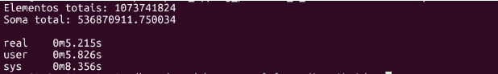
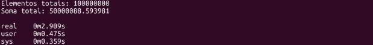
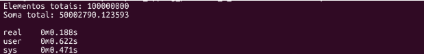

# Soma dos Elementos de um Vetor (Pthreads)

## 📋 Descrição do Problema
O objetivo desta atividade é implementar e avaliar um programa na linguagem C para realizar a soma dos elementos de um grande vetor de forma paralela. O foco está em explorar o ganho de desempenho ao dividir a carga de trabalho intensiva de processamento aritmético entre múltiplos núcleos utilizando a biblioteca `pthreads`.

## ⚙️ Ferramentas e Tecnologias
*   **Linguagem:** C
*   **Biblioteca de Paralelização:** POSIX Threads (`pthreads`)
*   **Compilador:** GCC com otimização `-O3`
*   **Ambiente de Execução:** Linux (Ubuntu via WSL)

## 💡 Fundamentos Teóricos e Metodologia
Para paralelizar o problema, o vetor de elementos é particionado logicamente pelo número de threads solicitadas:
1.  **Divisão de Carga:** O tamanho total do vetor (`nelem`) é dividido pelo número de threads, onde cada thread recebe um intervalo contíguo (índices de início e fim) definido por uma estrutura de dados (`ThreadData`). A última thread absorve qualquer resto da divisão.
2.  **Geração e Soma Local:** Cada thread gera de forma independente seus próprios números pseudoaleatórios utilizando a função thread-safe `rand_r()` com uma semente exclusiva baseada no ID da thread (`pthread_self()`). A soma é acumulada localmente em uma variável privada para evitar condições de corrida (*race conditions*).
3.  **Redução:** A função principal (`main`) aguarda o término de todas as threads através do `pthread_join()` e realiza a redução final, somando os resultados parciais isolados.

## 🚀 Como Compilar e Executar

### Compilação
```bash
gcc -O3 soma.c -o soma -lpthread
```

### Execução
```bash
# Executa usando o vetor padrão (1 bilhão de elementos) e 4 threads
./soma

# Executa definindo o tamanho do vetor (ex: 100 milhões) com 4 threads padrão
./soma 100000000

# Executa definindo 100 milhões de elementos e dividindo a carga para 8 threads
./soma 100000000 8
```

## 📊 Resultados e Análise

Executa usando o vetor padrão (1 bilhão de elementos) e 4 threads


Executa definindo o tamanho do vetor (ex: 100 milhões) com 4 threads padrão


Executa definindo 100 milhões de elementos e dividindo a carga para 8 threads


**Gargalo de Memória (1 Bilhão de Elementos):** No teste com o tamanho máximo, registrou-se um tempo de sistema (sys) muito elevado. Isso ocorreu devido ao custo do sistema operacional para alocar e entregar dinamicamente as páginas de memória necessárias para o vetor global.  

**Escalabilidade com 8 Threads:** No cenário com 8 threads, o tempo real de execução caiu para 0.188s. O tempo de usuário (user) superou o tempo real (real), confirmando que os núcleos do processador trabalharam simultaneamente, reduzindo o tempo total de espera.